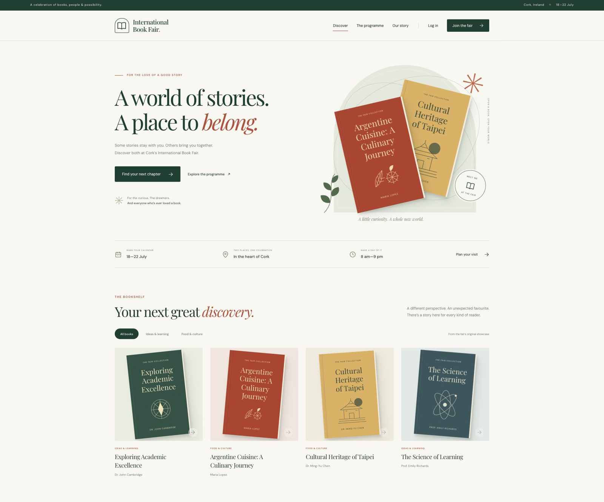

# International Book Fair

A React and Vite frontend for Cork’s International Book Fair, with visitor, exhibitor and administrator areas.

## Run locally

```sh
npm install
npm run dev
```

Open the local URL printed by Vite (normally http://localhost:5173).

## Build

```sh
npm run build
npm run preview
```

The production bundle is written to `dist/`. `public/_redirects` provides Netlify’s SPA fallback so direct links to routes work.

## Frontend

The public experience uses an ivory, forest-green and terracotta palette, editorial typography, locally rendered book illustrations, responsive navigation, a filterable bookshelf, accessible book and programme dialogs, venue directions, and matching account pages. Animations respect reduced-motion preferences.

- `src/index.css`: design tokens, shared styles and retained dashboard styling.
- `src/pages/Home.jsx` and `Home.css`: homepage sections and interactions.
- `src/data/fair.js`: original showcase books and programme entries.
- `src/components/BookCover.jsx`: reusable cover illustrations.
- `src/components/Modal.jsx`: native dialog with keyboard dismissal and restored focus.
- `src/components/AuthLayout.jsx`: shared account layout.
- `src/components/Footer.jsx`: navigation and fair companion.

Dates and programme details are retained from the original project. The expired July 2025 countdown has been replaced with practical visitor details; a new event year has not been assumed.

## Services

Authentication, registration, live book data and the live assistant retain the existing API at `https://apibookfair.danielefarriciello.dev/api/v1`. Those features require that service to be available and allow the frontend’s origin. The assistant’s quick questions work locally. No newsletter subscription service is configured.

The existing Axios development environment overrides are preserved in `src/api/axiosInstance.js`. No credentials are included in the frontend.

## Verification

- Production build passed.
- Desktop and mobile layouts inspected; no horizontal overflow observed.
- Checked bookshelf filtering, book details, programme dialog and Escape dismissal.
- Checked mobile navigation, password visibility, exhibitor registration fields and assistant quick answers.
- No homepage browser console errors observed.
- Account submissions and authenticated workflows were not exercised with real credentials.


